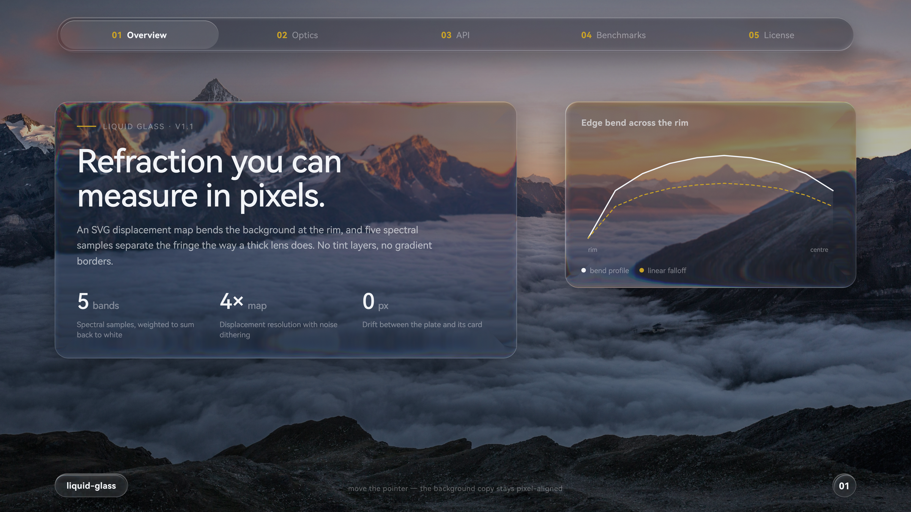
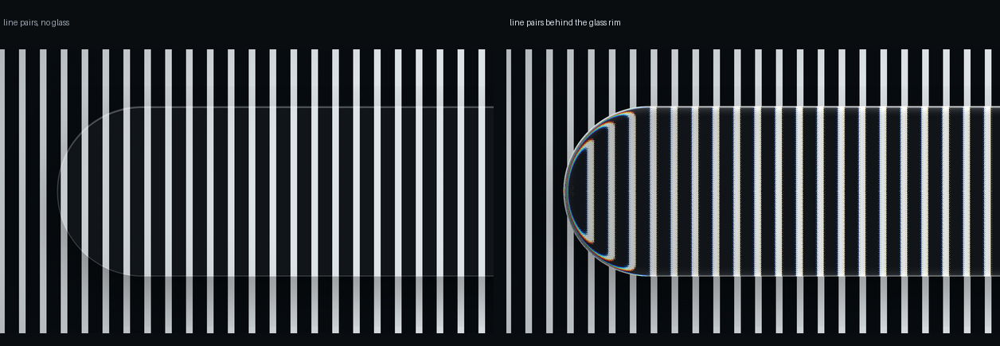
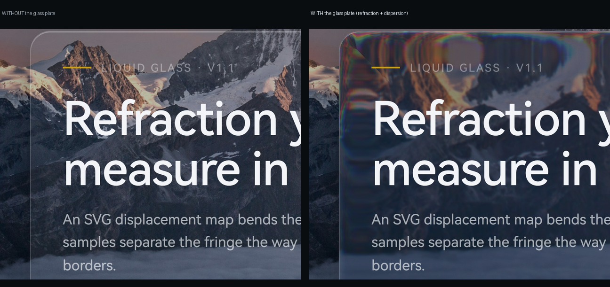
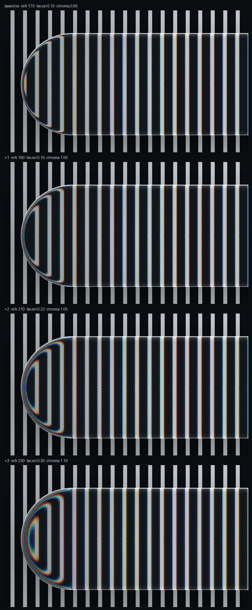

# better-liquid-glass-css

**真正会弯折背景的液态玻璃，跨 Chromium / Safari / Firefox 一致。**

不是磨砂叠色，也不是描边装样子：用 SVG `feDisplacementMap` 把玻璃背后的像素按透镜剖面位移，再用 **5 档光谱采样** 做色散。玻璃内部保持全透明，文字依旧清晰可选。



---

## 效果证据

左侧是无玻璃对照，右侧是同一位置盖上玻璃之后：竖条纹在边缘被压缩、弯折，高对比边缘出现青蓝／橙红的色散镶边。



同一页面的「有／无玻璃层」对比，看网格与斜纹在边缘的位移：



### 参数矩阵

同一块玻璃、同一背景，只改 `refraction` / `chroma`，从上到下逐级加强。
产品页用 baseline（92 / 0.56 / 0.55），在这之上把 `mapScale` 提到 8、`blur` 给 0.55，
彩边连成带、不会碎成一段段彩点。



| 档位 | refraction | bezel | chroma | 观感 |
| --- | --- | --- | --- | --- |
| **baseline（产品页默认）** | **92** | **0.56** | **0.55** | **干净通透，边缘一条细彩带** |
| +1 | 110 | 0.56 | 0.65 | 彩带变宽，仍克制 |
| +2 | 130 | 0.56 | 0.75 | 明显，接近写实厚玻璃 |
| +3 | 150 | 0.60 | 0.85 | 上限，细节开始被色边吃掉 |

---

## 它解决的两个问题

**一、折射必须真的折射。**
`backdrop-filter: blur()` 只能糊，`feDisplacementMap` 才能弯。引擎在运行时按透镜形状生成位移贴图：R/G 通道存水平/垂直位移量，B 通道存边缘高光，alpha 存透镜覆盖范围。文字不在玻璃内被扭曲——只有玻璃边缘之内的一段背景被弯折。

**二、玻璃层必须和卡片严丝合缝。**
常见做法是把背景复制进卡片内部再估一个偏移量，卡片只要有 1px 边框、或者 webfont 换入后宽度变化，复制层就整体错位，圆角两端露出没被玻璃盖住的一截。
本项目改为：整页背景副本固定在舞台原点，用 `clip-path: inset(… round …)` 按 `getBoundingClientRect()` 精确切出这张卡自己的矩形，并在字体加载完成、窗口缩放、以及 600ms 兜底时重新量一次。偏移量恒为 0。

---

## 相对上游的改进

| 改动 | 原因 |
| --- | --- |
| 色散从 3 通道扩到 **5 档光谱采样** | 3 通道会在边缘出现紫／绿／青三条硬带；5 档按 R→G→B 轴取样、权重在每个通道上加和为 1，彩边收窄且不偏色。试过 9 档：同一 `chroma` 下色带被填满，反而更宽更浑，已回退 |
| 透镜剖面表改为 **线性插值** | 原来按整格取表值，折射量呈阶梯 |
| 位移字节加 **有序抖动** | 8 位量化在 100px 级折射下会产生同心环 |
| 采样密度 **mapScale 4×** | 位移图分辨率翻倍，边缘过渡更连续 |
| 折射强度按元素短边收敛 | 42px 高的胶囊吃 92px 折射会被拉出边界，大卡片才需要强折射 |
| 独立的 `glass-plate.js` 接入层 | 把「背景副本 + 精确裁切 + 字体后重测」封装成一行调用 |

细节见 [MODIFICATIONS.md](MODIFICATIONS.md)。

---

## 快速开始

```bash
git clone https://github.com/haohaoo3o/better-liquid-glass-css.git
cd better-liquid-glass-css
python -m http.server 8000     # ES module 需要 HTTP，不能 file://
# 打开 http://localhost:8000/demo/ 与 /demo/optics.html
```

页面结构：背景层 + 卡片，卡片打 `data-glass`。

```html
<div class="stage">
  <div class="lg-bg"></div>      <!-- 背景图或渐变 -->
  <div class="lg-scrim"></div>   <!-- 压暗层 -->

  <section class="card glass" data-glass>…</section>
</div>

<script type="module">
  import { mountGlassPlate } from './src/glass-plate.js';
  mountGlassPlate(document.querySelector('.stage'), {
    layers: ['.lg-bg', '.lg-scrim'],
    chroma: 0.55,
    mapScale: 4,
  });
</script>
```

`stage` 必须是 `position: relative`（或 absolute/fixed）并带 `isolation: isolate`。

---

## API

### `mountGlassPlate(stage, options)`

| 参数 | 默认 | 说明 |
| --- | --- | --- |
| `targets` | `'[data-glass]'` | 需要玻璃效果的卡片选择器 |
| `layers` | `['.lg-bg', '.lg-scrim']` | 要复制进玻璃层的背景层，按绘制顺序 |
| `rim` | `90` | 折射带宽度，CSS px（按短边收敛） |
| `edge` | `1.4` | 最外缘向内采样的距离，单位是 rim |
| `curvature` | `4` | 剖面指数，2 为圆形、4 偏方、越大边缘越陡 |
| `chroma` | `0.45` | 色散强度，≈ 彩边宽度 / (rim × edge)；0 关闭 |
| `specular` | `0.86` | 边缘高光强度 |
| `specularWidth` | `2.4` | 高光宽度，CSS px |
| `blur` | `0` | 玻璃内部磨砂，CSS px |
| `mapScale` | `4` | 位移图像素密度，越高越顺滑、也越吃内存 |

返回 `{ refresh, instances, destroy }`。

单张卡片可在标签上覆盖：`data-refraction`、`data-bezel`、`data-curvature`、`data-chroma`、`data-specular`、`data-specular-width`、`data-blur`、`data-map-scale`、`data-radius`。

### `createGlass(target, options)`

底层引擎，直接对任意元素做透镜。返回 `{ update, flush, destroy }`。一般不需要直接调用。

---

## 调参建议

- **看不出「弯」，只有一圈亮边**：先把 `bezel` 调回 0.18–0.30。bezel 是折射带宽度，收得太小（如 0.07）等于把位移挤进几个像素，条纹只被平移、不被弯曲，这时加多少 `chroma` 都没用。
- **弯折幅度不够**：动 `refraction`（约短边×0.3–0.5）。`chroma` 只分离颜色，不改变几何位移。
- **边缘被拉出边界**：短边小于 64px 的元素把 `refraction` 收到短边×0.15 以内。
- **色散像三条硬带**：这是 3 通道引擎的固有问题，本项目默认 5 档；仍不满意可把 `mapScale` 提到 5–6。
- **两款页面的取舍**：光学测试页用 210 / 0.22 / 1.05 把效果讲清楚；产品页用 190 / 0.18 / 1.00，让正文不被拉变形。
- **玻璃发灰**：检查卡片背景是否叠了暗色 tint，或背景副本是否缺少某一层（`layers` 要与页面实际层数一致）。

---

## 浏览器与性能

- Chromium、Safari（含全部 iOS 浏览器）、Firefox 均使用同一套 SVG 滤镜路径；不支持时自动退回 `backdrop-filter` 磨砂。
- 每张卡片一张位移图。`mapScale: 4` 时，800×450 的卡片约 3200×1800 的离屏位图；桌面端十几张没问题，移动端建议降到 2–3，或只给首屏卡片启用。
- 页面缩放会重算位移图；频繁 resize 时可先 `destroy()` 再重建。

---

## 目录

```
src/liquid-glass.js     透镜引擎（上游 + 本项目改动）
src/glass-plate.js      背景副本 + 精确裁切 + 字体后重测
demo/index.html         产品化演示页
demo/optics.html        竖条纹光学测试页
scripts/shoot.py        渲染 README 截图（Playwright，3× 采样）
scripts/shoot_optics.py 渲染光学对照图
docs/                   README 用图
```

---

## Borrowed ideas

The rim model now follows [kubai087/glasswork](https://github.com/kubai087/glasswork) (MIT):

- the refracting band is an **absolute width** (`rim`, 90 CSS px here) clamped on small surfaces, not a
  fraction of the card — so a bigger card no longer gets a wider, muddier fringe;
- the very edge samples `edge × rim` inward (1.1–1.6), and the bend falls off as `(1 - d/rim)^power`;
- **dispersion is a fraction of the rim** (`0.45`: red bends ~45% further than blue). Our old `0.55`
  spread the channels ±55% and read as a broad rainbow; ~0.18 with a 40 px rim gives an ~11 px band;
- under-glass `blur + saturate + brightness` (kept to 0.8 px here) lifts the backdrop without fogging it.

## Credits

- 引擎基于 [gentpan/liquidglass](https://github.com/gentpan/liquidglass)（MIT）。
- rim 模型与色散量级参考 [kubai087/glasswork](https://github.com/kubai087/glasswork)（MIT）。
- `demo/assets/alpine.jpg` 来自 Unsplash（photo-1506905925346-21bda4d32df4），仅作演示背景。

## License

MIT。基于 [gentpan/liquidglass](https://github.com/gentpan/liquidglass)（MIT, © 2026 gentpan）修改，改动部分 © 2026 杨皓博。保留原始版权声明，详见 [LICENSE](LICENSE)。

## English

A refractive "liquid glass" implementation for the web. An SVG displacement map bends the pixels
behind each card at the rim, five spectral samples produce the chromatic fringe, and a page-anchored
backdrop copy is clipped to the card's exact border box so nothing drifts after webfonts settle.
Works in Chromium, WebKit and Gecko. MIT licensed, based on gentpan/liquidglass.
